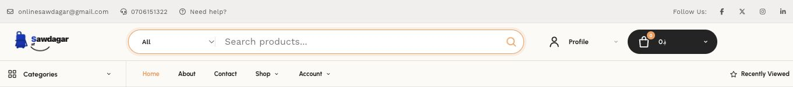

# Website search spacing and tab logo — 7 November 2026

## Changes

- Restore 16px of padding on both sides of the desktop search input. The later
  storefront style had reset the starting padding to zero beside the category
  selector.
- Use readable 14px desktop search text and 16px mobile search text. Mobile search
  fields also have internal spacing and retain the surrounding icon/button gaps.
- Show one orange focus ring around the complete search field, avoiding the
  additional rectangular input outline inside the rounded field.
- Register 32px and 48px PNG browser icons and a 180px Apple icon through Next
  metadata. The artwork is the existing Sawdagar blue bag/cart logo mark. Original
  logo and favicon assets are preserved; new URLs avoid reusing the old icon cache.

## Verification

Local browser checks covered the desktop header, search submission to
`/search?q=charger`, the mobile bottom search sheet and the mobile navigation
drawer. At 390px and 1024px there was no horizontal page overflow; input spacing,
font sizes and the single focus ring were checked from the rendered page.
Padding uses logical properties so it also applies in right-to-left layouts.

The separate VPS production build and temporary loopback preview passed. Live
checks on `https://sawdagar.com` confirmed the desktop 16px padding, mobile 16px
text with a single surrounding focus ring, and all three correct PNG icon links.
The website health check passed after activation. Backend and admin process IDs
were unchanged. Deployed application source: `9a691d29`.



## Restore points

- Git source backup: `backup/before-website-search-favicon-20261107`.
- New website release: `/var/www/releases/sawdagar/website-search-logo-20261107`.
- Previous complete release:
  `/var/www/releases/sawdagar/bb287f6aee96fac55a3596e44eb1b84b168651a0-20261012T075213Z`.

The new release contains a separate copy of the website. Its backend and admin
paths point to their unchanged previous release directories. Only the website
process needs a restart for this deployment or rollback.

To restore the previous live website on the VPS:

```sh
previous=/var/www/releases/sawdagar/bb287f6aee96fac55a3596e44eb1b84b168651a0-20261012T075213Z
ln -s "$previous" /var/www/apps/sawdagar/current.restore
mv -Tf /var/www/apps/sawdagar/current.restore /var/www/apps/sawdagar/current
pm2 restart sawdagar-website
curl --fail http://127.0.0.1:5000/ --output /dev/null
```

No database, product data, API, mobile app or admin source changes are part of
this release. Unrelated local mobile build settings remain outside this commit.
